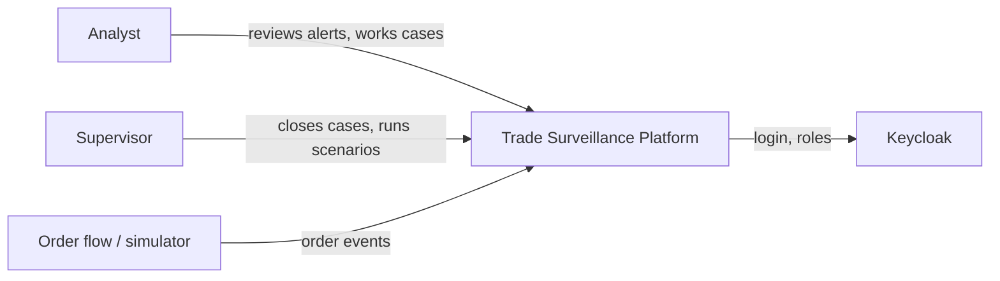
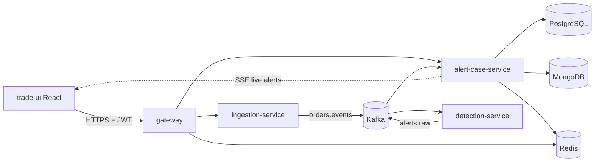
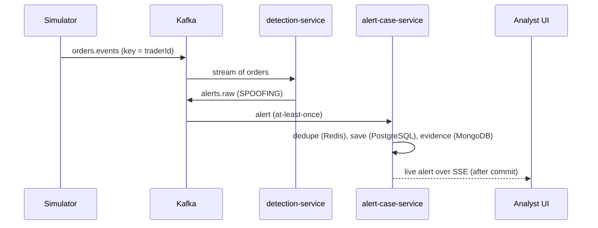

# Architecture

## 1. System context

Who uses the platform and what it talks to.

## 2. Containers

The services and data stores inside the platform.

## 3. Spoofing alert flow

What happens from an order to a live alert on the analyst's screen.

